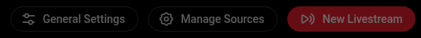
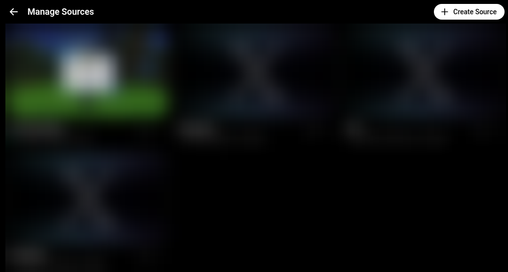
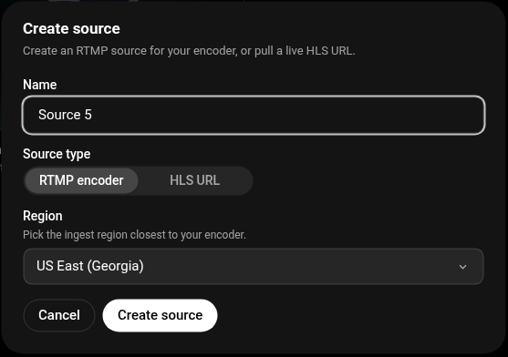
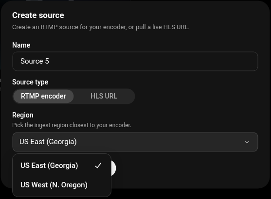
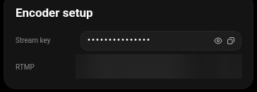
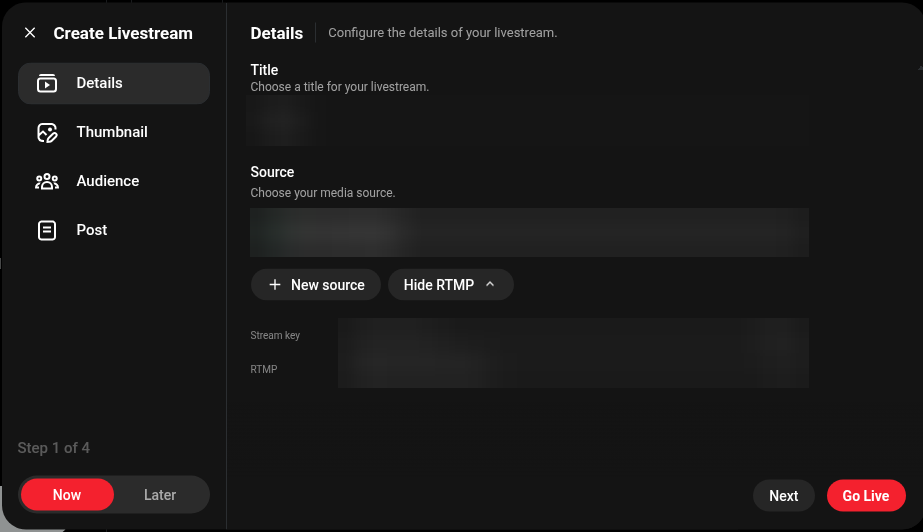
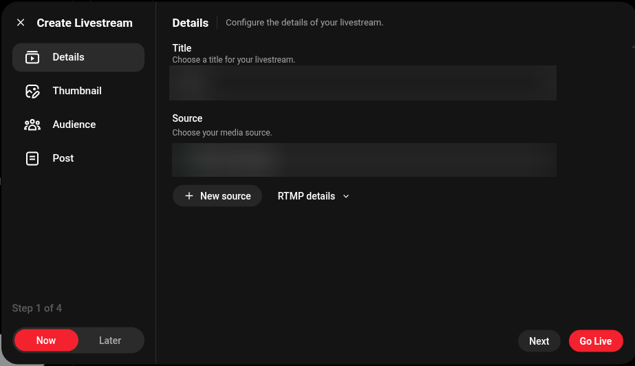
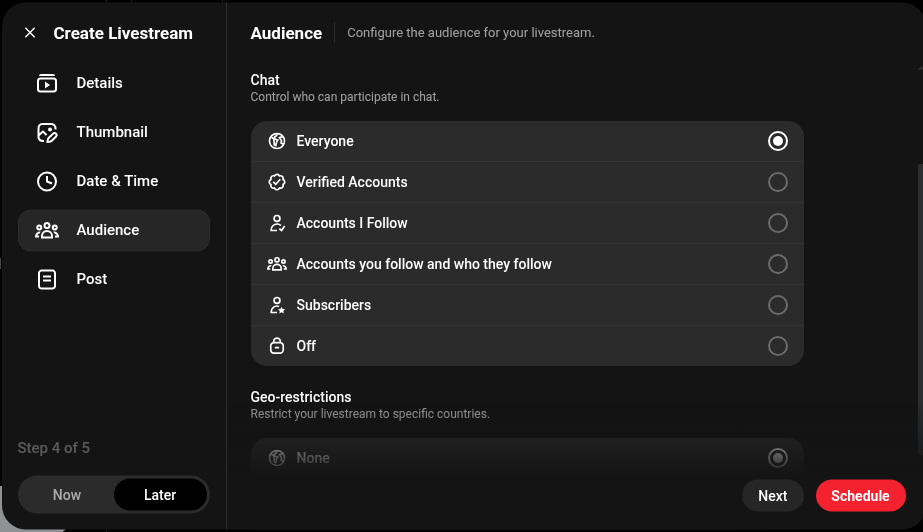

# PS5 X Live

A tiny macOS menu bar app that relays your PS5's gameplay broadcast to an X live stream.

It offers two modes:

- **Direct from PS5 (LAN) — recommended.** Your PS5 broadcasts to Twitch as usual, but a small bundled DNS server on your Mac catches the PS5's outgoing video on your LAN and forwards it copy-only to X. This is your own stream on your own network, the way Lightstream's console mode works.
- **Twitch Relay (opt-in).** Pull your public Twitch stream back down with [Streamlink](https://streamlink.github.io) and push it to X with [FFmpeg](https://ffmpeg.org). ⚠ **Use at your own risk: restreaming Twitch feeds may violate [Twitch's Terms of Service](https://www.twitch.tv/p/legal/terms-of-service/).**

```
Recommended (LAN):  PS5 broadcast  →  your Mac (LAN)  →  X
Twitch Relay:       PS5 broadcast  →  Twitch  →  your Mac  →  X
```

Both modes copy video and audio as-is, with no re-encoding, so they use almost no CPU.

**Nothing else to install.** FFmpeg (with OpenSSL), MediaMTX, Streamlink and the Python it runs on are bundled inside the app.

- Menu bar only (no Dock icon): **Start Relay**, **Stop Relay**, status, mode toggle, **Settings…**, **Setup Guide…**, **Open Log**, **Open X Live Studio**, **Help**, **About / Licenses**, **Quit**.
- **Setup Guide…** has a button for every link in the steps below.
- Your stream key is stored in the macOS Keychain.
- Reconnects automatically if the stream drops.

## Requirements

- **Apple silicon Macs only** (M1 or later), macOS 13 or later
- A [Twitch account](https://www.twitch.tv/signup) linked to your PS5 (Twitch requires two-factor authentication for PS5 broadcasts)
- An X account with access to [X Live Studio](https://x.com/i/live-studio). Live Studio availability depends on your X account.

## Install the app

1. Download `PS5-X-Live.zip` from the [latest release](https://github.com/blankspeaker/PS5-X-Live/releases/latest).
2. Double-click the zip, then drag **PS5 X Live.app** into **Applications**.

The app is ad-hoc signed, not notarized by Apple, so macOS blocks the first launch. Use one of these:

- **Right-click Open** (macOS 14 and earlier): in **Applications**, right-click (or Control-click) **PS5 X Live** → **Open** → **Open**.
- **Open Anyway:** double-click the app, close the warning, then go to **System Settings → Privacy & Security**, scroll to **Security**, click **Open Anyway** next to "PS5 X Live", and confirm.
- **Terminal:**

  ```sh
  xattr -dr com.apple.quarantine "/Applications/PS5 X Live.app"
  ```

After that it opens normally. The **Setup Guide** opens and step **1. Components** shows green checks for the bundled tools. There's nothing to install. If a component shows a red mark, the guide offers the Homebrew fallback (`brew install streamlink ffmpeg`); the relay uses Homebrew's tools only when the bundled ones can't run.

To start it automatically, add it in [Login Items](x-apple.systempreferences:com.apple.LoginItems-Settings.extension) (**System Settings → General → Login Items**).

**PS5 X Live opens in Direct from PS5 (LAN) mode by default.** You can switch to Twitch Relay from the menu bar icon; a confirmation and the risk note appear when you do.

## Create a source in X Live Studio

Both modes send video to an X "source". Create one once:

1. Open [X Live Studio](https://x.com/i/live-studio). The buttons at the top right are **General Settings**, **Manage Sources** and **New Livestream**.

   

2. Click **Manage Sources** ([direct link](https://x.com/i/live-studio/sources)), then **Create Source**.

   

3. In the **Create source** dialog, enter a **Name**, keep **Source type** on **RTMP encoder** (the default), and pick the **Region** closest to you: **US East (Georgia)** or **US West (N. Oregon)**. Click **Create source**.

    

4. Back on **Manage Sources**, click the source card's **Show stream key and encoder settings** icon button. The **Encoder setup** popover opens.
5. Copy the **Stream key** (the eye icon reveals it, the copy icon copies it) and the **RTMP** URL (copy icon). Use the URL exactly as shown; if an `rtmps://` URL is offered, prefer it. Both `rtmps://` and `rtmp://` work.

   

The same two rows also appear under **RTMP details** in the **Create Livestream** dialog.

   

Keep the stream key private. Anyone with it can stream to your source.

Then open **Settings…** in the app and paste the **Server URL** (the RTMP URL) and **Stream key**. (X username is optional; it enables the **Your X Profile** button.) Click **Save**.

## Direct from PS5 (LAN) mode — recommended

PS5 X Live receives the PS5's own outgoing Twitch broadcast on your LAN and forwards it to X, the way Lightstream's console mode works. This is the default mode.

How it works: a small bundled DNS server answers only Twitch's RTMP ingest hostnames (`*.contribute.live-video.net`, `ingest.global-contribute.live-video.net`, `live.twitch.tv`, `live-*.twitch.tv`) with this Mac's LAN IP **while the relay is running**, and forwards every other lookup upstream unchanged. It leaves `ingest.twitch.tv` (Twitch's TLS discovery endpoint) alone. The PS5's broadcast then arrives at a bundled [MediaMTX](https://github.com/bluenviron/mediamtx) RTMP receiver on this Mac, which forwards it copy-only to your X source. The DNS server answers LAN/loopback clients only, never the public internet.

**When the relay is stopped, the DNS server passes the Twitch ingest hostnames straight through, so your PS5 streams to Twitch normally.** The overrides turn on only when you press **Start Relay** and turn off again on **Stop Relay**. The menu shows **DNS: Twitch passthrough** or **DNS: Redirecting PS5 → X** so you always know which is active. The DNS server itself keeps running the whole time the app is open so the PS5 always has working internet.

Setup (the app's **Setup Guide** shows these with your Mac's IP filled in):

1. Enter your X source's RTMP URL and stream key in **Settings…** (see [Create a source in X Live Studio](#create-a-source-in-x-live-studio)).
2. On the PS5: **Settings → Network → Settings → Set Up Internet Connection → your network → Advanced Settings → DNS Settings → Manual**. Set **Primary DNS** to the Mac IP shown in the app and **Secondary DNS** to `0.0.0.0`. (Exact menu labels vary by PS5 software version.)
3. In the app choose **Start Relay**, then on the PS5 press **Create → Broadcast → Twitch → Go Live**.
4. Go live on X (see [Go live on X](#go-live-on-x)).

Revert when done: choose **Stop Relay** in the app (the PS5 can then reach Twitch normally again). You can leave the PS5's DNS set to the Mac; with the relay stopped it simply passes through. To stop pointing at the Mac entirely, set the PS5's **DNS Settings** back to **Automatic**.

## Twitch Relay mode (opt-in)

> ⚠ **Use at your own risk.** Twitch Relay pulls your public Twitch stream and restreams it to X. Doing so may violate [Twitch's Terms of Service](https://www.twitch.tv/p/legal/terms-of-service/). The recommended **Direct from PS5 (LAN)** mode above does not restream Twitch's servers. The app shows a confirmation every time you switch to this mode or start the relay in it.

Switch to this mode from the menu bar icon (**Mode: Twitch Relay**) and confirm the risk note.

1. Start broadcasting from your PS5 to Twitch:
   - On the PS5, link Twitch: **Settings → Users and Accounts → Linked Services → Twitch → Link Account**. Enter the code shown at [twitch.tv/activate](https://www.twitch.tv/activate) or scan the QR code.
   - In a game, press **Create**, select **Broadcast**, choose **Twitch**, and select **Go Live**. Sony's guide: [How to stream gameplay with Broadcast on PS5 consoles](https://www.playstation.com/en-us/support/games/ps5-stream-gameplay-broadcast/).
2. In **Settings…**, also enter your **Twitch channel** (your channel name or `twitch.tv/...` URL). YouTube live URLs also work (anything Streamlink can play), but Twitch is the tested path.
3. Choose **Start Relay** and confirm the risk note. The icon shows the state:

   | Icon | Status |
   | --- | --- |
   | Game controller | Idle |
   | Orange antenna | Waiting for Twitch |
   | Red antenna | Relaying to X |

   You can start the relay before or after the PS5 goes live; it waits for Twitch. Check your stream at `https://www.twitch.tv/<your channel>` (**Your Twitch Channel** in the Setup Guide).
4. Go live on X (see [Go live on X](#go-live-on-x)).

## Go live on X

Start the relay first, so your source shows a green dot or **Connected** in X Live Studio.

1. In [X Live Studio](https://x.com/i/live-studio), click **New Livestream**. In the **Create Livestream** dialog, keep **Now** selected at the bottom left.
2. **Details**: enter a **Title** and choose your source in the **Source** dropdown (it has a green dot when connected).

   

3. Optional: **Thumbnail**; **Audience** (Visibility **Public** or **Private**, **Chat**, **Geo-restrictions**); **Post** (the text of the announcement post).

   

4. Click **Next** through the steps, then click **Go Live**.

To schedule instead, choose **Later**. That adds a **Date & Time** step with **Auto-start**, and the final button becomes **Schedule**.

Check the broadcast on your X profile (`https://x.com/<your username>`, or **Your X Profile** in the Setup Guide).

To finish: end the broadcast in X Live Studio, choose **Stop Relay**, and stop the broadcast on the PS5 (**Create → Broadcast → Stop Broadcasting**). **Quit** also stops the relay.

## Latency

Expect roughly **8–15 seconds** from your TV to X viewers:

- PS5 encode and LAN/Twitch hop: a few seconds
- Relay (copy-only FFmpeg): about 1–2 s
- X's player buffer: the rest, outside this app's control

In Twitch Relay mode the pull uses `--twitch-low-latency --hls-live-edge 1`, the lowest setting. On an unstable connection this can stutter; see Troubleshooting.

## Troubleshooting

Open the log from the menu (**Open Log**), or at `~/Library/Logs/PS5-X-Live.log`. Stream keys are masked as `***` in the log.

| Problem | Fix |
| --- | --- |
| Red mark in **1. Components**, or a "Missing streamlink / ffmpeg" alert | Make sure the app is in **Applications** and was opened as in [Install the app](#install-the-app). Run the `xattr` command there. As a fallback, install [Homebrew](https://brew.sh) and run `brew install streamlink ffmpeg`. |
| "PS5 X Live is damaged and can't be opened" | Run the `xattr` command in [Install the app](#install-the-app). |
| LAN mode: PS5 can't broadcast / no internet | Make sure the app is open (the DNS server runs while it is). With the relay stopped the PS5 reaches Twitch normally; start the relay only when you want to send to X. |
| LAN mode: nothing arrives on the Mac | Confirm the PS5's **Primary DNS** is the Mac IP shown in the app, both are on the same LAN, and you pressed **Start Relay** (menu shows **DNS: Redirecting PS5 → X**). |
| Twitch Relay: stuck on **Waiting for Twitch** | Make sure the PS5 broadcast is live on your Twitch channel page. Check the channel name in **Settings…**. |
| PS5 broadcast stuck on "preparing" | Turn on two-factor authentication for your Twitch account, then relink Twitch on the PS5 ([twitch.tv/activate](https://www.twitch.tv/activate)). |
| Log shows `Connection refused`, `Input/output error` or a server error | Recheck the server URL and stream key in **Settings…**; copy them again from **Encoder setup** in [Manage Sources](https://x.com/i/live-studio/sources). |
| **Relaying to X** but nothing on X | Create the livestream and click **Go Live** in [X Live Studio](https://x.com/i/live-studio); the relay only feeds the source. |
| Source isn't green / **Connected** | Start the relay and wait, then reopen the **Source** dropdown. |
| Stuttering or buffering | Use wired Ethernet for the PS5 and the Mac, or lower the PS5 broadcast quality. |
| macOS asks for Keychain access | Choose **Always Allow**. Ad-hoc signed builds may ask again after an update. |
| App won't open ("unidentified developer" / "Apple could not verify") | See [Install the app](#install-the-app). |
| Audio missing on X | The relay switches to AAC audio automatically if X rejects the copied audio; check the log for "switching to AAC". |
| Why not the **HLS URL** source type? | X can also pull an HLS playlist (**Source type → HLS URL**), but Twitch playlist URLs expire, so the relay is the reliable path. |

Still stuck? [Open an issue](https://github.com/blankspeaker/PS5-X-Live/issues).

## Build from source

Requires an Apple silicon Mac with the Xcode Command Line Tools (`xcode-select --install`).

```sh
git clone https://github.com/blankspeaker/PS5-X-Live.git
cd PS5-X-Live
./build.sh
open "build/PS5 X Live.app"
```

`build.sh` runs `scripts/build-runtime.sh` the first time. That script downloads, checksum-verifies and assembles the bundled runtime:

- FFmpeg 8.1.3 from the official source tarball, compiled as a minimal **LGPL** build (no GPL or nonfree parts) with RTMPS via **statically-linked OpenSSL 3.5.9**
- OpenSSL 3.5.9 from the official source release (static, for FFmpeg's TLS)
- MediaMTX (official release binary) as the LAN-mode RTMP receiver
- CPython 3.13 from [python-build-standalone](https://github.com/astral-sh/python-build-standalone)
- Streamlink and its dependencies from PyPI, pinned by hash in `scripts/requirements-runtime.txt`

Then `build.sh` compiles `Sources/main.swift` with `swiftc` for arm64, copies the relay script, DNS server, runtime and license files into the app, ad-hoc signs every nested executable and the app, and writes `build/PS5-X-Live.zip`.

## Licenses and third-party software

PS5 X Live is MIT licensed. The bundled FFmpeg (LGPL-2.1-or-later), OpenSSL (Apache-2.0), MediaMTX (MIT), CPython (PSF-2.0) and Python packages keep their own licenses; they run as separate processes and aren't linked into the app binary. See [THIRD_PARTY_NOTICES.md](THIRD_PARTY_NOTICES.md) for every component's version, license, upstream, exact download and SHA-256, and [`ThirdPartyLicenses/`](ThirdPartyLicenses) for the license texts. The same files are in the app (**About / Licenses**).

## Disclaimer

PS5 X Live is an independent project. It is not affiliated with, endorsed by, or sponsored by Sony Interactive Entertainment, Twitch or X Corp. PlayStation, PS5, Twitch and X are trademarks of their respective owners and are used here only to describe compatibility.

Twitch Relay mode restreams your Twitch feed and may violate Twitch's Terms of Service; use it at your own risk. Direct from PS5 (LAN) mode is recommended.

### Command line

The relay script also works without the app:

```sh
PS5XL_MODE=lan \
PS5XL_SERVER='rtmps://…' \
PS5XL_KEY='…' \
"/Applications/PS5 X Live.app/Contents/Resources/ps5xlive-relay.sh" start   # also: stop, status
```

## License

[MIT](LICENSE) © blankspeaker
